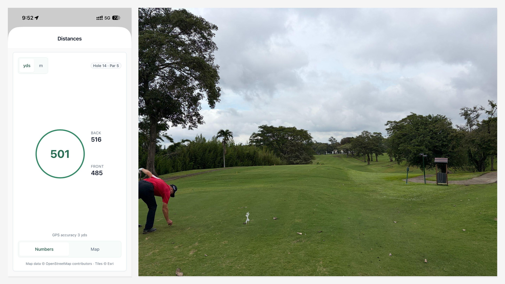
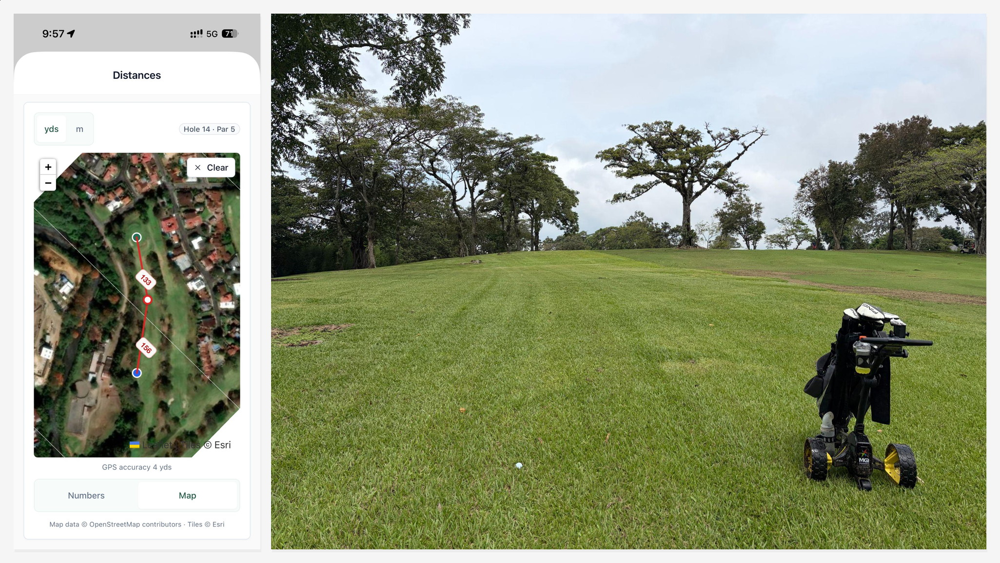
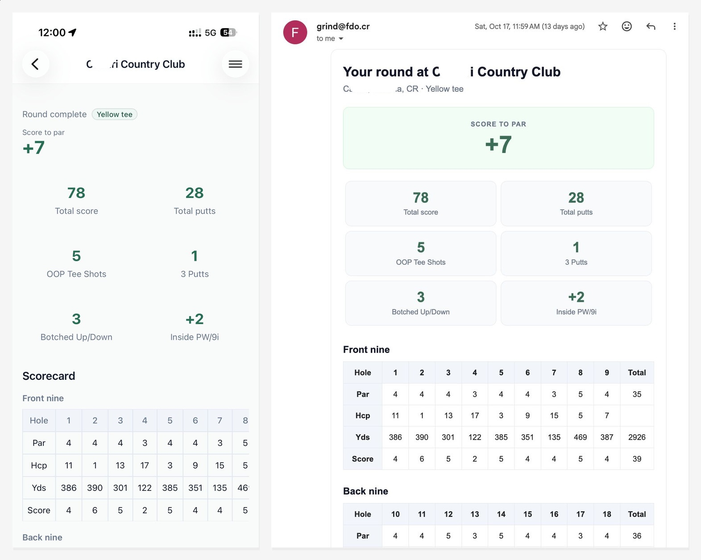

In the age of software abundance I built [my own rangefinder app for when I golf](https://grind.fdo.cr). I have one VPS where I stack weekend projects using the [ONCE CLI](https://github.com/basecamp/once), I love that thing.

## Golf

If you're not familiar with golf, it's pretty important to know the distance to your target. For roughly half of those shots you actually do benefit from a rangefinder (laser, GPS watch, mobile app, etc) so a billion dollar industry exists to solve that problem for golfers.

I belong to the subset of players that puts in some effort to improve their game and I found inspiration on YouTube. A different approach to stats that aren't exactly the well known stats used in golf. I was intrigued.

Since I was already fed up with the ads on an app's free tier I used at the time, it was clear to me I could build my own. One that would help me understand the stats I wanted to improve and serve as a rangefinder while I play, all in one app.

## The stack/architecture

[Grind](https://grind.fdo.cr) is Open Source. It was built with the goal of anyone being able to use it without registering and even without the mobile app.

The mobile app does provide some nice perks and an account will keep your history at hand (scores and stats), but even "in incognito" you can simply get your round summary sent to your inbox when you're finished.

Agents did most of the heavy lifting but I was pretty intentional on the building blocks I wanted grind to have. Here are some notes about it:
- Ruby on Rails with the "Solid Stack" on SQLite makes cramming a bunch of low traffic projects in a single VPS a breeze
- Hotwire is simple to read and understand as a human with rails exposure (both Ruby/Rails code and also Stimulus/JS)
- Hotwire Native for the mobile app is so simple, all of a sudden I have access to native GPS features and a better UX across some lovely details compared to a PWA on iOS
- On the golf course we could lose internet connection so a PWA service worker is essential, which makes support for Android low hanging fruit (Hotwire Native on Android is a nice to have)
- CI/CD with git tags on GitHub Actions and GitHub Packages. ONCE simply deploys the public Docker image

## Yardages

It sounds easy, but we need GPS coordinates in a polygon shape and do some math to know how far our current device's GPS coordinates are from our target (the green). We need front, center and back of the polygon, and the front/back are relative to your position (they're not perfect circles).

Since & repeat for 18 holes. Fun stuff that took a couple of hours to code with agents before it was usable.

On the course you don't always get to see the hole (your target) from where you're standing. Here's a side by side view of what I see and what grind shows me:

There's actually two views: The simple numbers screen (above) and the map screen (below). The map is great to split a long distance and plan out your next shot(s).

This was my view after my first shot. It was quite poor and I still had a long way to go (still can't see the target):

## The round

Once you're finished this is what the stats and the email you get looks like:

## Conclusions

These are all pretty standard rangefinder app features. Incumbents actually have a smoother UI (native instead of web based) and better datasets (golf courses and their GPS coordinates). Those native apps weigh hundreds of megabytes though and grind is 810 KB. Grind can be tweaked to my liking or to [someone's request/suggestion on GitHub](https://github.com/fdocr/grind) anytime *\*wink\** *\*wink\**

I've been using it every round I play and it's been great. Check it out at [grind.fdo.cr](https://grind.fdo.cr) or in the [iOS App Store](https://apps.apple.com/us/app/grind-golf/id6787446479) if interested

Pura vida.
